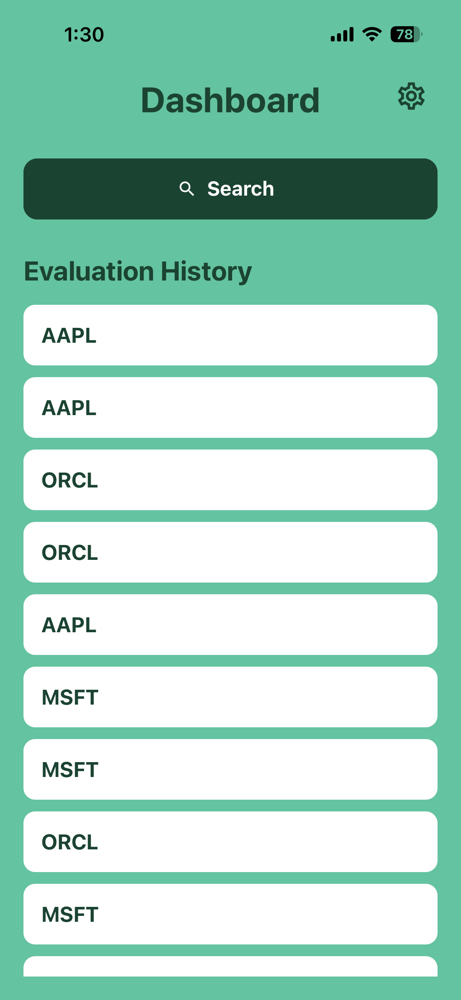
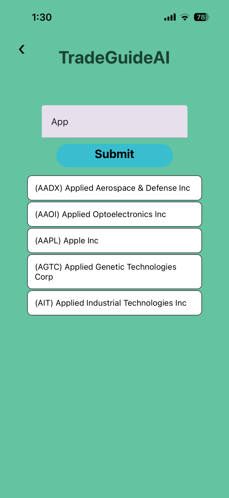
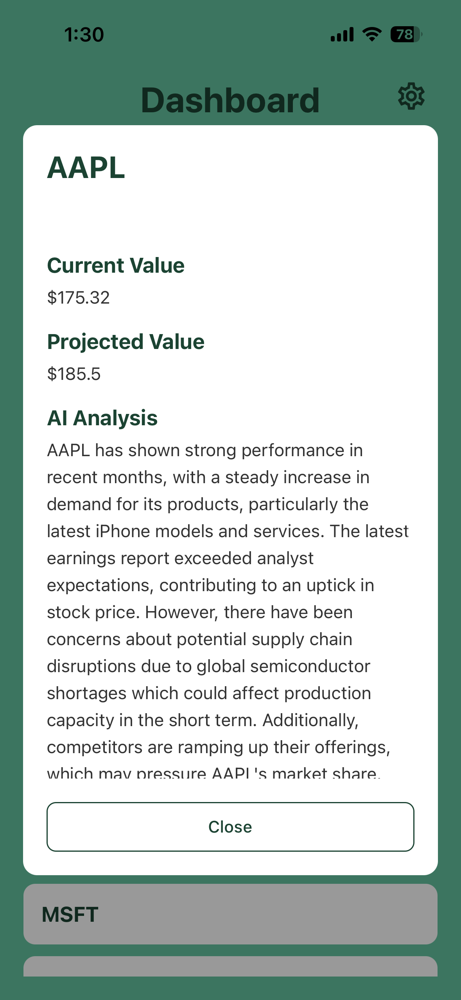
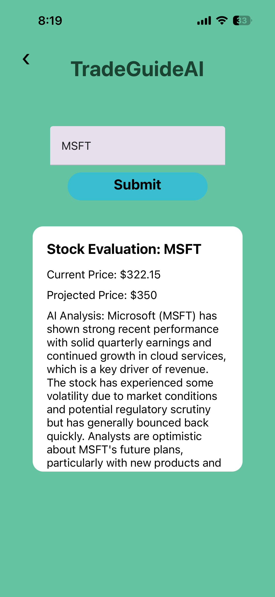
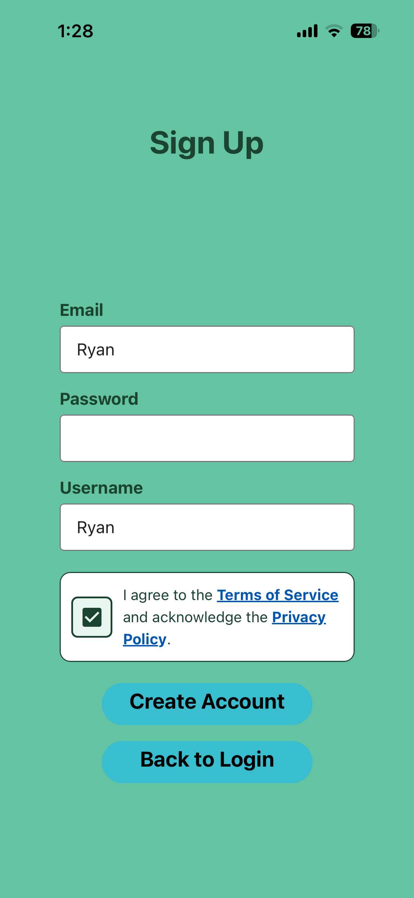
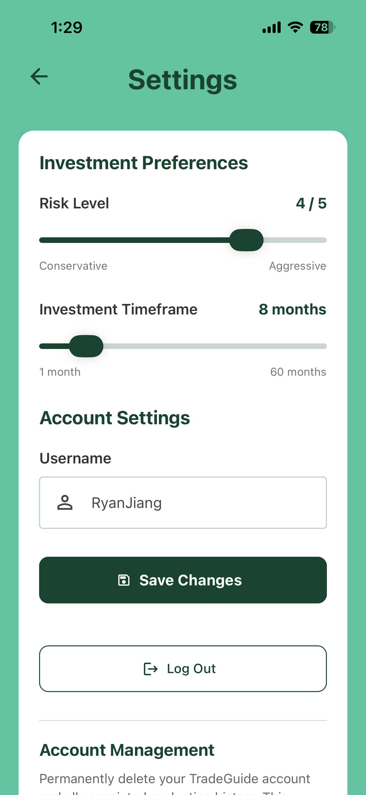

# TradeGuide

**AI-powered stock research and evaluation mobile app**

TradeGuide is a full-stack mobile application that helps users explore publicly traded stocks and view AI-generated evaluations tailored to their risk tolerance and investment timeframe. It combines a React Native frontend, a Java Spring Boot REST API, and a PostgreSQL database with stock-market and AI APIs.

> **Note:** TradeGuide is a research and educational tool, not a brokerage or trading app. AI predictions are estimates, not financial advice.

## Features

- **Stock discovery:** Search by company name or ticker symbol, with autocomplete suggestions.
- **Personalized AI evaluations:** View stock-price information, projected values, and written analysis informed by a user's risk level and investment timeframe.
- **Evaluation history:** Revisit previously generated stock evaluations from the dashboard.
- **Customizable preferences:** Set risk level (1–5), investment timeframe (1–60 months), and username.
- **Account management:** Sign up, log in, log out, and delete an account.
- **Backend protections:** JWT-authenticated requests, BCrypt password hashing, and per-user daily evaluation limits.

## App screenshots

### Dashboard, stock discovery, and analysis

<table>
  <tr>
    <th>Dashboard &amp; history</th>
    <th>Stock search &amp; autocomplete</th>
    <th>Saved evaluation details</th>
  </tr>
  <tr>
    <td></td>
    <td></td>
    <td></td>
  </tr>
</table>

### AI-powered stock evaluation

<p align="center">
  
</p>

<p align="center">
  <em>Personalized AI stock evaluation based on the user's risk tolerance and investment timeframe.</em>
</p>

### Accounts and preferences

<table>
  <tr>
    <th>Login</th>
    <th>Sign up</th>
    <th>Settings</th>
  </tr>
  <tr>
    <td></td>
    <td></td>
    <td></td>
  </tr>
</table>

## Tech stack

| Layer | Technologies |
| --- | --- |
| Mobile frontend | React Native, Expo, JavaScript, React Native Paper |
| Backend API | Java, Spring Boot, Spring Data JPA |
| Database | PostgreSQL |
| Authentication | JWT, BCrypt, Expo SecureStore |
| Market data | Alpha Vantage API |
| AI integration | OpenRouter API |
| Deployment | Railway (backend) |

## How it works

1. The user logs in and configures their risk tolerance and investment timeframe.
2. The mobile app sends a stock search or evaluation request to the Spring Boot API.
3. The backend validates authentication and applies usage-limit rules.
4. The backend obtains stock-price information from Alpha Vantage and requests AI-generated analysis through OpenRouter.
5. The app displays the evaluation and allows the user to revisit saved evaluation history.

```text
React Native + Expo
       |
       | HTTPS / JSON + JWT
       v
Spring Boot REST API -------- PostgreSQL
       |
       +---------------------- Alpha Vantage (stock data)
       |
       +---------------------- OpenRouter (AI evaluation)
```

## Engineering highlights

- Implemented authenticated REST endpoints backed by persistent user data.
- Integrated third-party market-data and AI services into a mobile workflow.
- Built stock autocomplete and a dashboard for viewing evaluation history.
- Added configurable investment preferences and account deletion.
- Deployed the backend to Railway with configuration managed separately from source code.

## Running locally

This project requires separate frontend and backend configuration, a PostgreSQL database, and API credentials for Alpha Vantage and OpenRouter. Supply credentials using local environment variables or configuration excluded from version control; never commit secrets. Start the Spring Boot backend and run the Expo app using the development instructions appropriate to each project directory.

> Repository-specific commands and required environment-variable names can be added here once the folder structure and configuration are documented.

## Disclaimer

TradeGuide is provided for educational and informational purposes. Stock prices may be delayed; projections and AI-generated explanations may be incomplete or inaccurate. Nothing in the app constitutes financial advice or guarantees future results.
